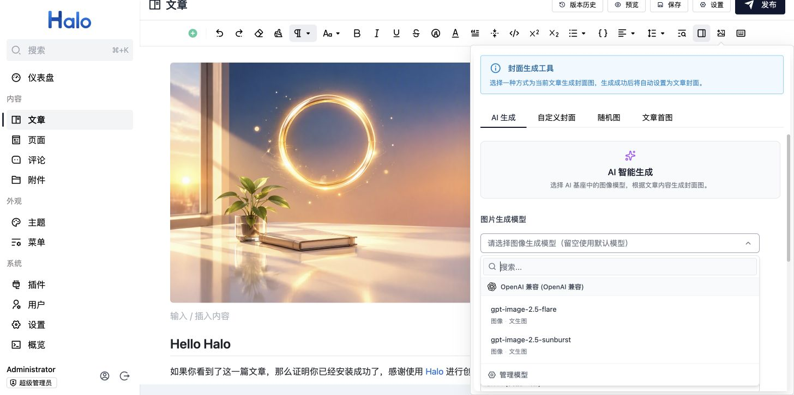
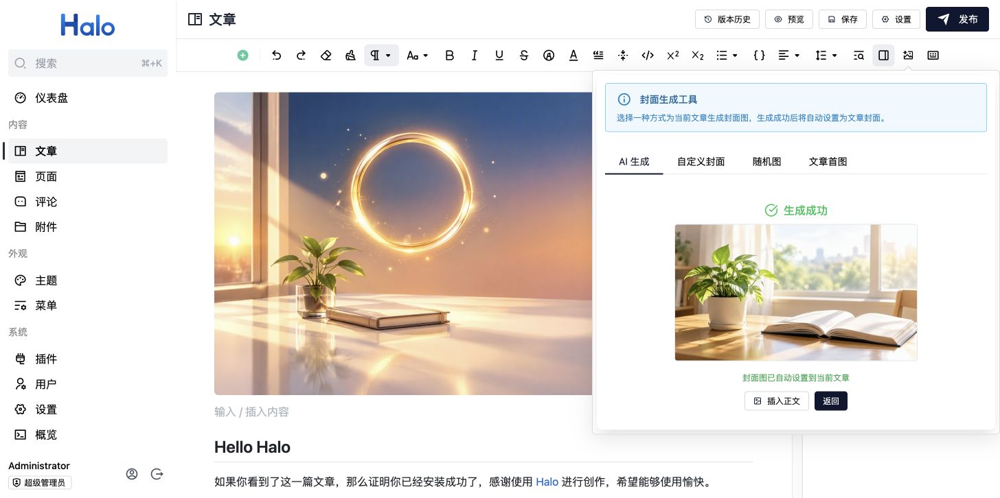
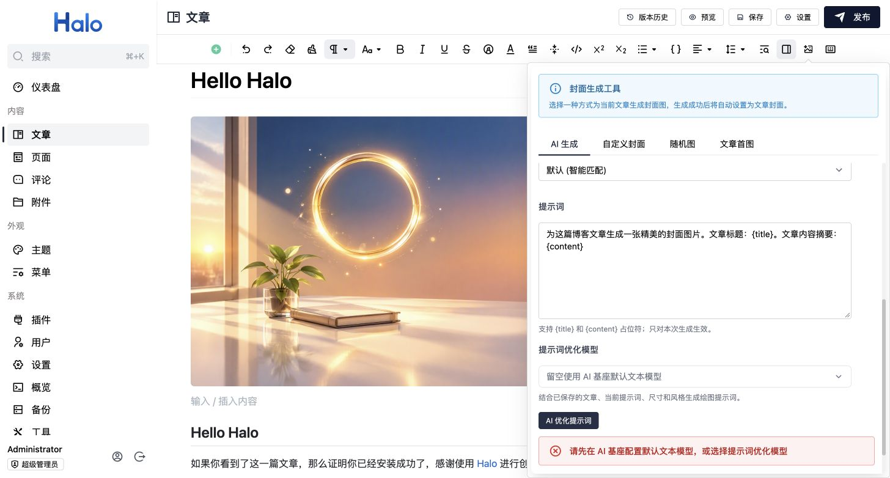
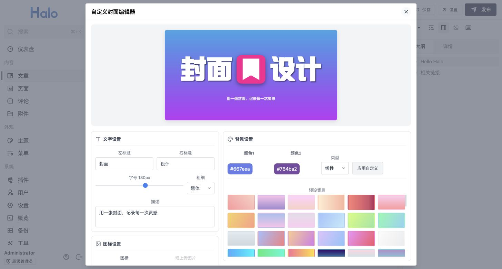
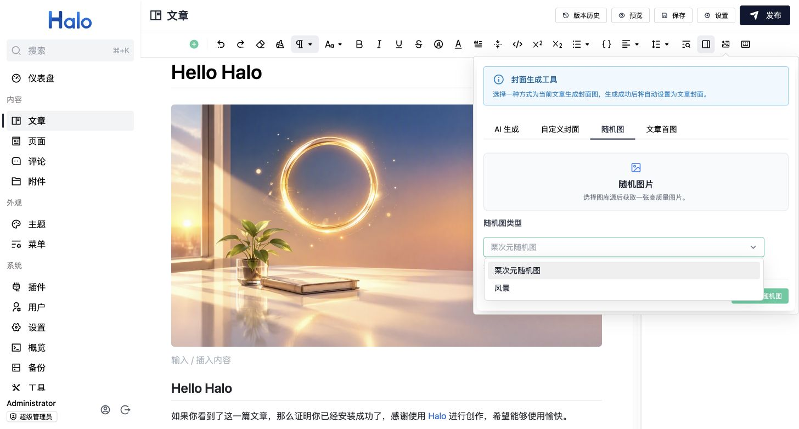
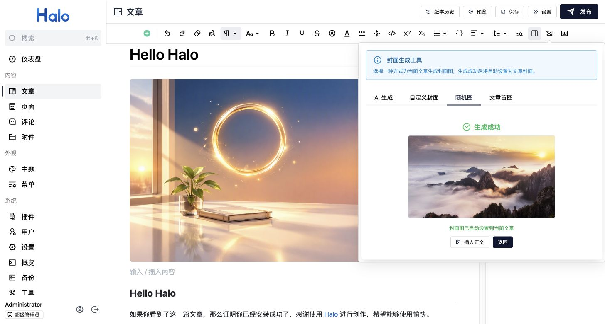
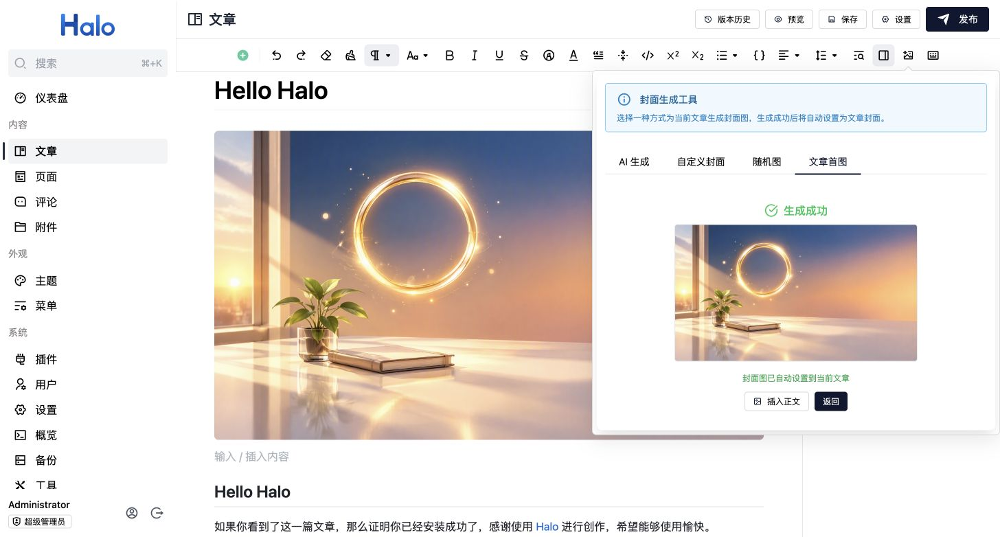
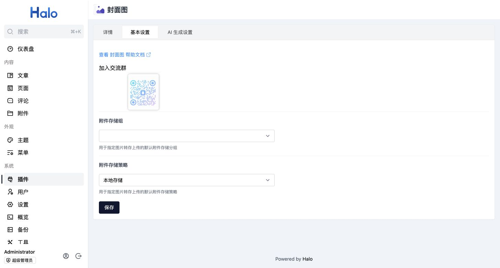

# plugin-coverImage

Halo 文章封面生成插件，支持 AI 图像生成与提示词优化、可视化封面设计、随机图库和文章首图。

当前版本 **1.2.0**，需要 **Halo 2.27.0+**，并安装启用 **Halo AI Foundation 1.x**。
从 1.1.x 升级时，请将原来直接配置的模型供应商、API 地址和密钥迁移到 AI Foundation；旧的 CodeSphere / 火山方舟配置不再读取。

## 功能特性

| 功能 | 说明 |
| --- | --- |
| AI 生成 | 使用 Halo AI Foundation 的图像模型，根据文章内容生成封面，可选择模型、尺寸或比例、风格和提示词 |
| AI 优化提示词 | 使用文本模型优化绘图描述，结果填回输入框供编辑，支持撤销本次优化 |
| 可视化设计 | 编辑左右标题、字号、粗细、描述、SVG / 附件图标和渐变背景，可下载图片或直接使用 |
| 随机图库 | 选择栗次元随机图或风景，为文章快速配图 |
| 文章首图 | 提取已保存正文中的第一张图片作为封面 |
| 发布时补齐 | 文章发布且封面为空时，按文章设置的来源尝试自动生成 |

## 快速使用

1. 安装并启用 [Halo AI Foundation](https://github.com/halo-dev/plugin-ai-foundation) 和本插件。
2. 在「插件 → 封面图 → 基本设置」中选择附件存储策略并保存。
3. 编辑并保存文章，点击编辑器工具栏中的「封面生成工具」。
4. 选择生成方式，等待完成并预览结果。成功后自动设为文章封面，也可以继续「插入正文」后保存。

AI 图像生成需要可用的图像模型，提示词优化需要文本模型。供应商、API Key 和模型启用状态统一在 AI Foundation 中管理；选择模型时留空则使用对应的默认模型。随机图、首图和手工设计无需调用 AI 模型。

## 功能截图

以下截图来自 Halo 2.27 后台的真实操作。图像模型名称取决于你的 AI Foundation 配置，安装插件不会自动添加截图中的模型。

### AI 图像生成

选择可用的图像模型，按模型能力调整尺寸或比例，并设置风格与本次提示词。生成素材来自已保存文章的标题和清理格式后的内容摘要。



生成过程中保持页面打开，面板显示状态和耗时。成功后自动设置封面并显示预览，无需再次上传。



### AI 优化提示词

选择文本模型并点击「AI 优化提示词」，结合文章内容、当前提示词、尺寸和风格生成绘图描述。优化后可以继续编辑或撤销；点击「开始生成」才会调用图像模型。

截图环境尚未配置文本模型，因此展示实际的配置提示；配置文本模型后即可使用，失败时会保留原提示词。



### 可视化封面设计

在 1200 × 630 画布中调整文字、图标和背景，预览同步更新。点击「下载图片」保存 PNG，或点击「确认使用」上传并设为文章封面。



### 随机图库

选择「栗次元随机图」或「风景」，点击「获取随机图」，成功后可预览并插入正文。





### 文章首图

正文中插入图片并保存文章后，选择「文章首图 → 提取首图」，即可将正文第一张图片设置为封面。



### 附件与默认提示词

插件设置保留附件存储组、存储策略和默认提示词。自定义封面与 Base64 格式的 AI 图片需要有效的附件存储策略。



默认提示词支持 `{title}` 和 `{content}` 占位符。生成面板可以临时修改提示词；留空时使用插件设置中的默认提示词，修改只影响本次生成。

## 文档
详细的图文使用文档：[封面图插件](https://docs.lik.cc/plugins/cover-image/)。

## 交流群


## 开发环境

插件开发的详细文档请查阅：<https://docs.halo.run/developer-guide/plugin/introduction>

所需环境：

1. Java 21
2. Node 22.12+
3. pnpm 9
4. Docker (可选)

克隆项目：

```bash
git clone git@github.com:acanyo/plugin-coverImage.git

# 或者当你 fork 之后

git clone git@github.com:{your_github_id}/plugin-coverImage.git
```

```bash
cd path/to/plugin-coverImage
```

### 运行方式 1（推荐）

> 此方式需要本地安装 Docker

```bash
# macOS / Linux
./gradlew pnpmInstall

# Windows
./gradlew.bat pnpmInstall
```

```bash
# macOS / Linux
./gradlew haloServer

# Windows
./gradlew.bat haloServer
```

执行此命令后，会自动创建一个 Halo 的 Docker 容器并加载当前的插件，更多文档可查阅：<https://docs.halo.run/developer-guide/plugin/basics/devtools>

### 运行方式 2

> 此方式需要使用源码运行 Halo

编译插件：

```bash
# macOS / Linux
./gradlew build

# Windows
./gradlew.bat build
```

修改 Halo 配置文件：

```yaml
halo:
  plugin:
    runtime-mode: development
    fixedPluginPath:
      - "/path/to/plugin-coverImage"
```

最后重启 Halo 项目即可。

## 致谢

感谢以下开发者的贡献和支持：

- [困困鱼](https://wwww.kunkunyu.com) - 提供了宝贵的建议
- [柳意梧情](https://blog.muyin.site) - 提供了技术支持

## 许可证

本项目采用 GPL-3.0 许可证 - 查看 [LICENSE](LICENSE) 文件了解详情
